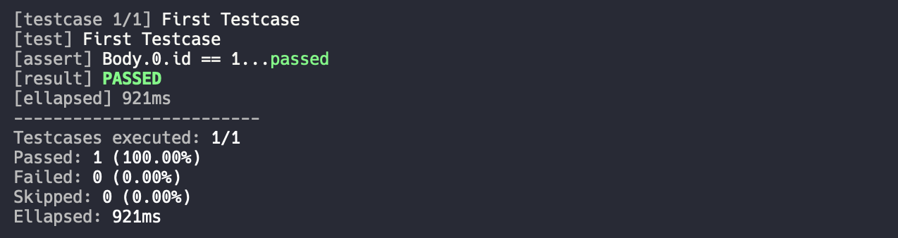

# Get Started

Cotton is a command line tool. You can install from package managers like homebrew or others, or build from [source](https://github.com/chonla/cotton).

## Installation

### Homebrew (Mac OS)/Linuxbrew (Linux)

```bash
brew tap chonla/universe
brew install cotton
```

## First Testcase

Create a markdown file (text file with `.md` extension) with the following content.


# First Testcase

```http
GET https://fakestoreapi.com/products HTTP/1.1
```

- `$[0].id` == `1`
- `$[0].title` =~ `/product/i`


## Execute Testcases

```sh
cotton ./first-testcase.md
```

Or to run all tests in a directory:

```sh
cotton ./tests
```

With a custom timeout:

```sh
cotton ./tests --timeout 45000
```

You should see the output like this in your terminal.

